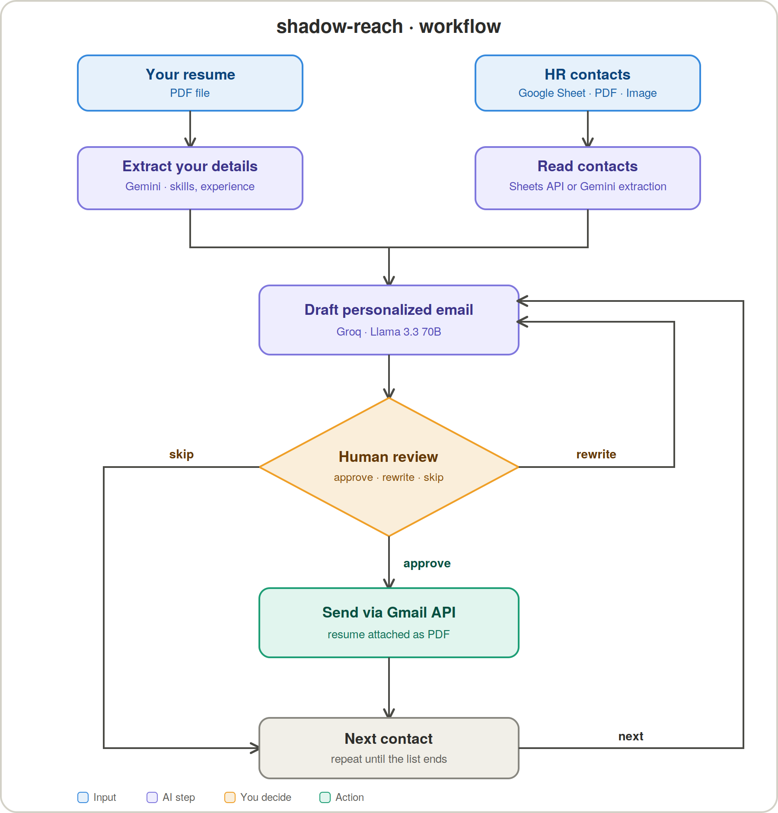

# 🕶️ shadow-reach

An AI agent that automates personalized recruiter outreach. It reads HR contacts from a Google Sheet or an uploaded document, extracts your details from your resume, drafts a personalized cold email for each contact, lets you approve, rewrite or skip each draft, and sends the approved ones from your Gmail with your resume attached.

## 🚀 How to Run

### 1. Clone the repository

```bash
git clone https://github.com/Vinsmoke-R/shadow-reach.git
cd shadow-reach
```

### 2. Create and activate a virtual environment

```bash
python -m venv venv

# Windows (PowerShell)
venv\Scripts\activate

# macOS / Linux
source venv/bin/activate
```

### 3. Install dependencies

```bash
pip install -r requirements.txt
```

### 4. Get your API keys

| Service | Used for | Where to get it |
|---|---|---|
| **Groq** | Writing the email drafts | https://console.groq.com |
| **Google Cloud (OAuth)** | Reading Google Sheets and sending Gmail | https://console.cloud.google.com |

### 5. Set up Google OAuth (Sheets + Gmail)

1. Create a project in Google Cloud Console.
2. Enable the **Google Sheets API** and the **Gmail API**.
3. Go to **APIs & Services → Credentials → Create Credentials → OAuth client ID** (type: *Desktop app*).
4. Download the JSON file and save it as `credentials.json` in the project root.
5. On the OAuth consent screen, add your own Gmail address as a **test user**.

On the first run a browser window opens asking you to sign in. After you approve, a `token.json` file is created automatically, so you won't be asked again.

### 6. Create a `.env` file

In the project root, create a file named `.env`:

```env
GROQ_API_KEY=your_groq_api_key
SHEET_ID=your_google_sheet_id
RANGE = your_sub-sheet_name
RESUME_PATH=resume.pdf
```

> `SHEET_ID` is the long string in your Google Sheet URL:
> `https://docs.google.com/spreadsheets/d/<SHEET_ID>/edit`

### 7. Prepare your inputs

- **Your resume:** a PDF file.
- **HR contacts:** either a Google Sheet (name, email and company columns) **or** an HR list as a PDF/PNG/JPG.

### 8. Run the agent

```bash
python main.py
```

Choose your contact source (`sheets` or a document). For every contact, the agent shows a draft email and asks for your decision:

| Decision  -> What happens |
| `approve` -> The email is sent from your Gmail with your resume attached |
| `rewrite` -> The LLM generates a fresh draft for the same contact |
| `skip` -> Moves on to the next contact |

> ⚠️ **Security:** never commit `.env`, `credentials.json` or `token.json`. Make sure they are in `.gitignore`.

---

## 🎯 What Are We Doing?

Cold-emailing recruiters works, but it's slow and repetitive. You have to find contacts, write a fresh email for each one, attach your resume and keep track of who you reached out to. **shadow-reach** automates that pipeline while keeping you in control of every email that goes out.

### The workflow



### Step by step

1. **Resume parsing:** Gemini(currently using Groq) reads your resume PDF and extracts your name, role, skills, experience, education and achievements.
2. **Contact collection:** HR contacts (name, email, company) are read from a Google Sheet or extracted from an uploaded PDF/image.
3. **Email drafting:** An LLM writes a short, human-sounding email for each recruiter (under 150 words), using your real skills and ending with a call to action.
4. **Human approval:** Built with LangGraph's `interrupt`, the agent pauses on every draft and waits for your decision. Nothing is sent without your OK.
5. **Sending:** Approved emails go out from your own Gmail account with your resume attached.

### Tech stack

- **Python**
- **LangGraph:** agent workflow with human-in-the-loop interrupts
- **Groq (Llama 3.3 70B):** email generation
- **Google Gemini:** resume and document extraction ( currently using Groq)
- **Google Sheets API and Gmail API:** contacts and sending
- **Pydantic:** contact validation

### Project structure

| File | Purpose |
|---|---|
| `main.py` | LangGraph agent that connects all the steps |
| `llm.py` | Prompts the LLM to draft the recruiter email |
| `data_extract.py` | Extracts resume data and HR contacts using Gemini |
| `sheets_reader.py` | Reads HR contacts from Google Sheets |
| `gmail_reader.py` | Gmail authentication and email sending (with attachment) |
| `requirements.txt` | Python dependencies |

### Development journey

Built step by step: Gmail and Sheets connection → graph flow up to drafting → human-in-the-loop → sending mail → switching from `input()` to LangGraph `interrupt` → working MVP.

### Roadmap

- [x] Resume and document extraction
- [x] Personalized email drafting
- [x] Google Sheets contact reader
- [x] Human-in-the-loop approval with `interrupt`
- [x] Gmail send with resume attachment
- [ ] Application tracking (who was contacted and the status)
- [ ] Follow-up emails
- [ ] Persistent checkpointing (currently in-memory)
